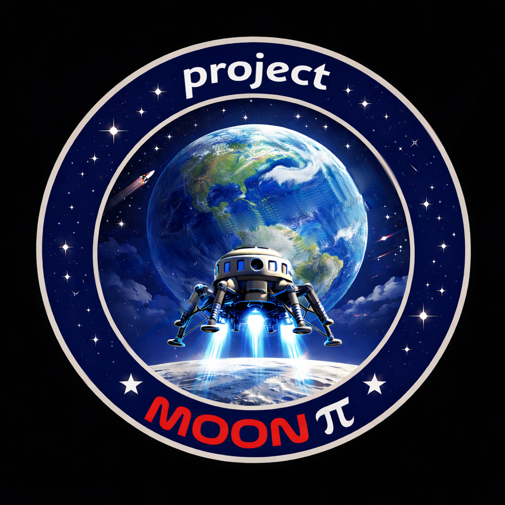
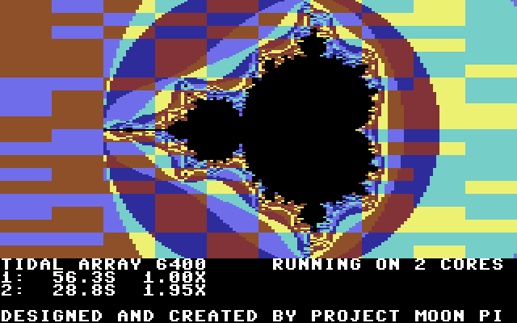
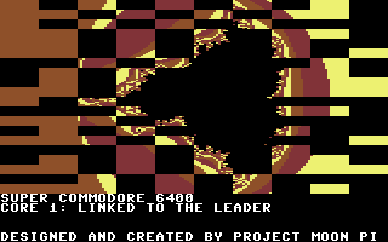

<b>Designed and Created by Project Moon Pi</b>

# Super Commodore 6400

Several **NTSC Commodore 64s** joined into one machine. Each C64 is a "core". One leader hands out work, and
every core, the leader included, computes its share. The goal is a pack of 8 or more C64s, sharing RAM through
a cartridge-port hub and running from one clock. Each machine added should make the whole thing about that much
faster, and the benchmark shows it on screen.

It is one of the [Project Moon Pi Commodore projects](https://github.com/projectmoonpi/commodore).

**Step 1 (this release): two C64s on a user-port cable.** It has the core kernel, the job protocol, and a
Mandelbrot benchmark with a live speed-up readout.

*Left: the leader's screen after the two-core run. The leader's own tiles are blue and cyan; core 1's are red,
orange and yellow. Right: core 1's own monitor, showing only the tiles it computed. Both are rendered from the
two-machine simulator's memory.*

## Results

| Cores | Simulator | VICE (real C64 timing) | Speed-up |
|---|---|---|---|
| 1 | 56.3 s | 60.2 s | 1.00× |
| 2 | 28.8 s | not tested: VICE can't link two C64s | **1.955×** |

That's 97.8% of a perfect doubling. The rest is the time spent passing tiles over the cable and the moment at
the end when one core finishes before the other.

The simulator doesn't count the cycles the VIC chip steals for the screen. That's the 7% gap on one core. Every
core loses the same share, so the speed-up is unchanged.

## What you need

- 2 NTSC C64s, each able to load the programs. Any of these works:
  - a disk drive with `sc6400.d64`, or an SD2IEC / Pi1541;
  - the `.prg` files on a Kung Fu Flash or other SD cartridge;
  - the cartridge images: `sc6400-leader.crt` and `sc6400-core.crt`. These are Magic Desk cartridges (32 KB
    and 16 KB) for a Kung Fu Flash, or burned to a Magic Desk-compatible EPROM cartridge. They start the
    program at power-on, and the reset button starts it again.
- A user-port-to-user-port cable (below).

## The cable

**Build it with the illustrated guide:
[Build Guide 1: the user-port link cable (PDF)](docs/guides/SC6400-Guide-1-Link-Cable.pdf).** It covers your
start and end goals, drawings of the finished cable and of the two C64s hooked up, a schematic, the parts
with DigiKey part numbers, how to find pin 1 on your C64, colour-coded wiring
and solder maps, numbered steps, a digital-multimeter test checklist, the first run, and troubleshooting. The table below
is the short version.

Two 24-pin (2×12, 0.156") user-port edge connectors, wired:

| Signal | C64 A pin | C64 B pin |
|---|---|---|
| PB0–PB7 (data) | C, D, E, F, H, J, K, L | C, D, E, F, H, J, K, L (straight through) |
| PC2 → FLAG | 8 | B |
| FLAG ← PC2 | B | 8 |
| GND | 1, 12, A, N | 1, 12, A, N |

Leave everything else unconnected. Never connect +5 V (pin 2), RESET (3) or 9 V AC (10, 11).

For safety, put a 330 Ω resistor in series with each data line (PB0–PB7). If a program ever drove the lines
from both ends at once, the resistors limit the current. The protocol never does this (the simulator counts
it, and it stayed at 0), but other software could. The resistors don't slow the link.

## Running it

1. Switch on the worker C64 and load the core: `LOAD"PACK CORE",8` then `RUN`, or plug in the core cartridge. It shows **CORE: WAITING FOR THE
   LEADER**.
2. On the leader C64: `LOAD"PACK LEADER",8` then `RUN`, or use the leader cartridge. It scans the cable, uploads the job to the core, and
   shows **CORES 2**. The core's screen changes to **CORE 1: LINKED TO THE LEADER**.
3. Press **1** to run on the leader alone, then **2** to run on both. Each result shows its time and its
   speed-up over the 1-core run. Press **S** to scan the cable again, for example after switching a core on.

## How it works

**The link.** Port B of CIA 2 carries 8 data bits. Every read or write of port B pulses PC2, which the other
machine sees on its FLAG input:
- writing a byte says "here is a byte";
- reading it says "got it".

That gives a fully handshaked byte transfer of about 30 cycles, around 30 KB/s. The leader drives the data
lines. When a core answers, the two sides hand the lines over with a "line free" pulse, so they never drive
at the same time.

**The core kernel** (`src/common.asm`) is a few hundred bytes. It obeys three commands:

| Command | Bytes | What the core does |
|---|---|---|
| WRITE | `$01` addr len data… | stores the data in its memory |
| READ | `$02` addr len | sends that memory back |
| CALL | `$03` addr A | runs `JSR addr` with A, then pulses "done" |

The cores are generic: the leader uploads the job (5 KB) when it finds a core. The same program could hand
out any other work.

**The benchmark** (`src/job.asm`) draws the whole Mandelbrot set at 160×160 multicolour pixels, in 200 tiles
of 16×8.
- Tiles are handed out one at a time, to whichever core is free, so fast and slow tiles balance out.
- The leader computes tiles too. After every 4 pixels it checks the cable. When the core says "done", the
  leader collects the tile's 32 bytes and gives the core the next one.
- Maths: 8.8 fixed point, at about 200 cycles an iteration. While a point is in play |z| < 2, so each value's
  high byte is 0 or 1. A square is then a table look-up, and a product is one 8×8 quarter-square multiply.

**Timing.** CIA 1's timer A counts cycles and timer B counts timer A's underflows, giving an exact 32-bit
cycle count.

## Building and testing

`./build.sh` assembles everything with ACME, writes `build/sc6400.d64` and the two cartridge images
(`src/cart.asm`, `tools/make_crt.py`), and runs the test.

VICE 3.8 can't connect two C64s through their user ports. So `tools/packsim.c` simulates two C64s joined by
the cable:
- a 6510 with all documented opcodes and cycle counts;
- the memory map, CIA timers and raster interrupts;
- port B, PC2 and FLAG, wired as above.

`tools/simcheck.py` then checks the result:
- runs the auto-test leader (`-DAUTO=1`: 1 core, then all cores);
- compares every tile with a Python copy of the job's maths;
- counts which core did which tile;
- reports any contention on the cable;
- writes `build/sim-0.png` and `build/sim-1.png`.

The leader's picture from VICE matches the simulator's byte for byte.

## Roadmap

1. **Two C64s, user-port cable.** Software, protocol and benchmark. *This release: tested in simulation and in
   VICE; real hardware next.*
2. **Clock-injection bench test.** One 14.31818 MHz master clock fed to two C64s, with the crystal left in
   place but bypassed. The mod board must suit every motherboard revision (250407, 250425, 250466 and 250469),
   set with a switch or jumpers. The test also checks that the hub can line the machines up by dropping clock
   pulses.
3. **Pack Link pod and a 2-port hub.** A cartridge-port pod in each C64, ribbon cables, and an FPGA hub with
   fast shared SRAM, mailboxes and IRQs. That gives full-speed shared memory instead of a cable.
4. **The 8-port hub.** An 8-core benchmark and the video wall.

## Credits

- **Design, code and the Project Moon Pi logo.** Project Moon Pi.
- **Character set.** Copied at run time from the C64's own character ROM (© Commodore). It is not included
  here. The simulator reads VICE's copy for its renders.
- **ACME** cross-assembler. Marco Baye and contributors (GPL).
- **VICE** emulator and `c1541`. The VICE team (GPL).
- **Python and Pillow.** Their authors (PSF / HPND licences).
- **Palette values.** The "colodore" C64 palette by Philip "Pepto" Timmermann.
- **Quarter-square multiplication.** A classic 6502 technique, as documented on codebase64.org.
- **User port pinout and CIA behaviour.** The *Commodore 64 Programmer's Reference Guide* and the MOS 6526
  datasheet.
- Built with Claude Code (Anthropic).

Commodore 64 is a trademark of its owners. Project Moon Pi is not affiliated with them.
